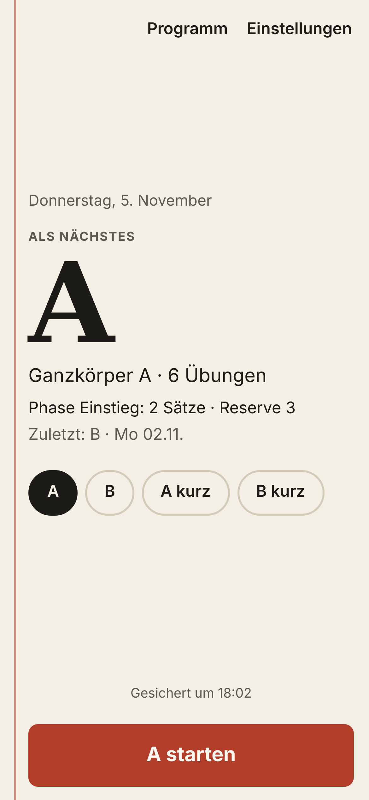
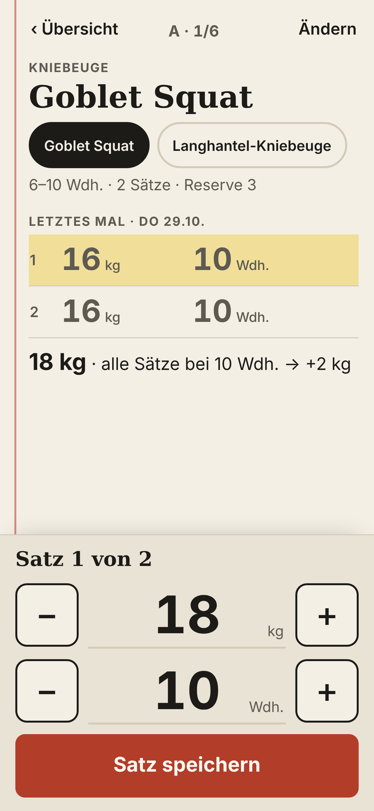
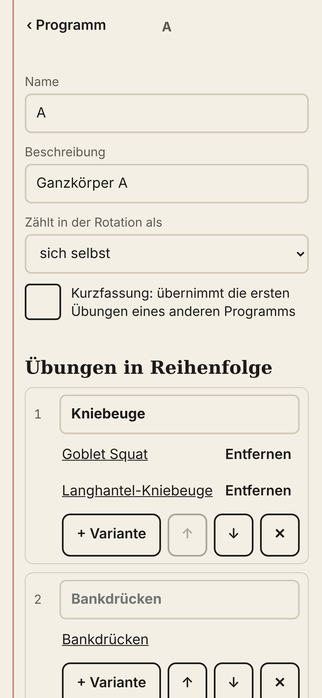
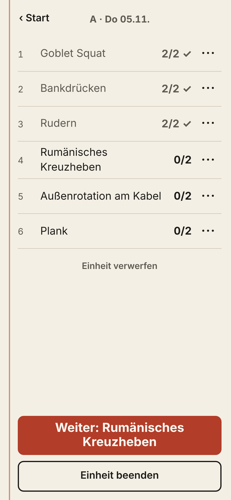
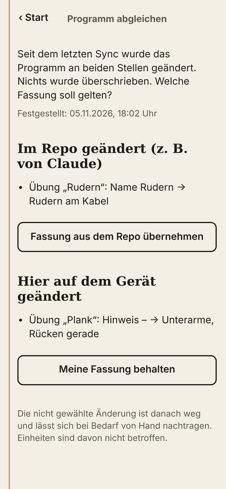
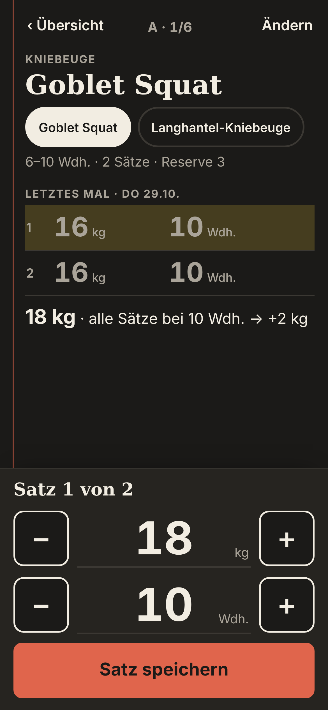

# gym-log

Satz-Log fürs Krafttraining: nach jedem Satz Gewicht und Wiederholungen festhalten – einhändig, offline, in Sekunden. Jede beendete Einheit landet als Commit im privaten Repo `BabyPython67/claude-projekte` unter `gym/`, wo Claude sie in anderen Chats als Trainer liest.

<p>



</p>

## Wofür

Mirko trainiert seit dem 29.10.2026 zweimal pro Woche Ganzkörper A und B im Wechsel. Die App soll genau eine Sache gut machen: zwischen zwei Sätzen zeigen, was letztes Mal war und was jetzt dran ist, und den Satz mit einem Tap speichern. Keine Streaks, keine Diagramme, keine Zahlen-Dashboards – frühere Anläufe sind genau daran gescheitert.

Was sie kann:

- **Eintragen:** Jeder Satz ist vorausgefüllt (vorgeschlagenes Gewicht, Wiederholungen desselben Satzes vom letzten Mal). Stimmt es, reicht ein Tap auf „Satz speichern“. Weicht es ab: −/+ oder auf die Zahl tippen.
- **Gewichtsvorschlag nach der Steigerungsregel:** erst erhöhen, wenn in der letzten Einheit dieser Übung alle Sätze das obere Ende der Spanne geschafft haben – dann um die Schrittgröße der Übung. Ohne Historie: „Gewicht suchen“.
- **Rotation und Phasen:** Die App schlägt die Einheit vor, die dran ist (A → B → A …), zeigt Satzzahl und Reserve der aktuellen Phase. „A kurz“/„B kurz“ für Klausurwochen zählen als A bzw. B.
- **Flexibel im Gym:** Übung nur für heute ersetzen (aus dem Katalog oder neu mit nur einem Namen) oder auslassen, ohne das Programm zu ändern.
- **Programm als Daten:** Übungen, Varianten, Spannen, Reihenfolge, Schrittgrößen, Phasen, Messarten und beliebig viele Programme mit frei einstellbarer Rotation – in der App oder direkt in `programm.json`.
- **Hält Jahre:** offline zuerst, Sync nach GitHub (ein Commit pro Einheit), neues Gerät lädt die Historie aus dem Repo, Export als JSON und CSV.

## Einrichtung

### 1. GitHub Pages einschalten (einmalig, nach dem Merge)

1. Auf github.com das Repo **gym-log** öffnen → **Settings** → **Pages**.
2. Unter „Build and deployment“: **Source: Deploy from a branch**, **Branch: `main`**, Ordner **`/ (root)`** → **Save**.
3. Nach ein bis zwei Minuten steht oben die Adresse, voraussichtlich **https://babypython67.github.io/gym-log/**.

Es gibt keinen Build-Schritt: Pages liefert die Dateien so aus, wie sie im Repo liegen.

### 2. Token erzeugen (fine-grained, nur für das Daten-Repo)

1. **https://github.com/settings/personal-access-tokens/new** öffnen (Settings → Developer settings → Personal access tokens → Fine-grained tokens → Generate new token).
2. **Token name:** `gym-log iPhone` · **Resource owner:** `BabyPython67`.
3. **Expiration:** „Custom“ und das späteste erlaubte Datum wählen (höchstens ein Jahr). Das Datum notieren – die App erinnert 14 Tage vorher, wenn du es einträgst.
4. **Repository access:** „Only select repositories“ → **`BabyPython67/claude-projekte`** (nur dieses).
5. **Permissions → Repository permissions → Contents: Read and write.** Sonst nichts. („Metadata: Read-only“ setzt GitHub automatisch dazu.)
6. **Generate token**, den Token (beginnt mit `github_pat`) kopieren. Er wird nur einmal angezeigt.

Der Token liegt danach nur auf dem iPhone (im Speicher der App). Er steht nicht im Code, nicht in diesem Repo, nicht im Export und taucht in keiner Meldung auf. Gesendet wird er ausschließlich an `api.github.com`.

### 3. Auf den Home-Bildschirm legen

1. Die Pages-Adresse in **Safari** auf dem iPhone öffnen.
2. **Teilen**-Symbol → **Zum Home-Bildschirm** → **Hinzufügen**.
3. Ab jetzt **immer über das Symbol** öffnen. Wichtig: Die Home-Bildschirm-App hat auf dem iPhone einen eigenen Speicher, getrennt vom Safari-Tab. Was im Tab eingetragen wird, sieht die App nicht (und umgekehrt).
4. In der App **Einstellungen** → Token einfügen, „Token gültig bis“ eintragen → **Speichern und synchronisieren**. Repo (`BabyPython67/claude-projekte`) und Ordner (`gym`) sind voreingestellt.

Beim ersten Sync legt die App `gym/programm.json` aus dem Startinhalt an (falls es sie noch nicht gibt). Gibt es sie schon, gilt die Fassung im Repo.

## Bedienung

**Start.** Groß steht die Einheit, die laut Rotation dran ist, darunter Phase, Satzzahl und Reserve sowie die letzte Einheit. Eine andere Einheit wählt man über die Knöpfe darunter (A, B, A kurz, B kurz, …). **„A starten“** führt direkt in die erste Übung. Ganz unten eine Zeile zum Sync-Stand („Gesichert um 18:42“, „Offline – wird gesichert, sobald Netz da ist“, „Token abgelaufen“ …); ein Tipp darauf öffnet die Einstellungen.

**Übungsansicht** (der Bildschirm zwischen den Sätzen):

- Oben Name, Variante (z. B. Goblet Squat / Langhantel-Kniebeuge – umschaltbar, solange noch kein Satz drin ist), Spanne, Satzzahl, Reserve.
- **Letztes Mal** mit Datum und allen Sätzen; der Satz, mit dem du dich gerade vergleichst, ist wie mit Textmarker hinterlegt. Darunter der Vorschlag mit Grund („18 kg · alle Sätze bei 10 Wdh. → +2 kg“, „40 kg bleiben · 2 Sätze unter 10 Wdh.“, „Gewicht suchen“).
- **Heute**: die schon gespeicherten Sätze. „Ändern“ öffnet einen Satz zum Korrigieren oder Löschen.
- Unten im Daumenbereich: **Satz n von m**, Gewicht und Wiederholungen mit −/+ (Schritt = Schrittgröße der Übung bzw. 1 Wdh.), Tipp auf die Zahl öffnet die Zifferntastatur. **Satz speichern**.
- Nach dem letzten Satz: **Weiter: nächste Übung** oder **Noch ein Satz**; nach der letzten Übung **Einheit beenden**.
- Jedes Speichern, Löschen, Auslassen und Beenden zeigt kurz **Rückgängig** – es gibt keine Bestätigungsdialoge.

**Oben rechts „Ändern“** (bzw. „···“ in der Übersicht): Variante wählen, **Nur heute ersetzen** (Suchfeld; ein neuer Name legt die Übung mit Standardwerten im Katalog an), **Heute auslassen**. Das Programm bleibt dabei unverändert.

**Übersicht** („‹ Übersicht“): alle Übungen der Einheit mit Stand (2/2 ✓, 0/3, ausgelassen), **Weiter: …**, **Einheit beenden**, **Einheit verwerfen**.

**Einheit beenden** speichert und synchronisiert nach etwa 8 Sekunden (so lange gilt „Rückgängig“). Eine vergessene, offene Einheit wird nach 6 Stunden Ruhe automatisch mit der Zeit des letzten Satzes beendet. Am selben Tag lässt sich die letzte Einheit über **Letzte Einheit korrigieren** wieder öffnen.

**Programm** (oben auf dem Start): Programme, Rotation, Phasen und Übungskatalog bearbeiten – siehe „Programm ändern“.

**Einstellungen:** Token, Gültigkeitsdatum, Repo, Ordner, Branch, **Jetzt synchronisieren**, **Export JSON**, **Export CSV**, **Export-Datei importieren**, App-Version.

## Datenformat in claude-projekte

*Dieser Abschnitt ist für Claude, der die Daten liest und das Programm ändert.*

Alles liegt im Ordner `gym/` (in der App änderbar). Die App schreibt nur dort, immer als **ein Commit pro Sync** über die Git-Data-API. Ein anderer Prozess (der Garmin-Sync in `garmin/`) darf jederzeit dazwischen pushen: Die App lädt dann neu und wiederholt.

```
gym/
  programm.json        Programm – Claude darf es ändern
  einheiten/2026.json  Rohdaten: alle Einheiten eines Jahres mit allen Sätzen
  uebersicht.md        lesbar, neueste Einheit zuerst (wird erzeugt)
  stand.md             letzter Sync, letzte Einheit, aktuelle Phase (wird erzeugt)
```

### uebersicht.md (zum schnellen Lesen)

Eine Zeile pro Einheit, neueste zuerst:

```
- 2026-11-05 · A · Goblet Squat 18 kg: 10, 10 · Bankdrücken 40 kg: 10, 9 · Rudern (statt Rumänisches Kreuzheben) 35 kg: 10, 10 · Plank: 45 s, 40 s · Außenrotation am Kabel ausgelassen
- 2026-11-02 · B · Beinpresse 80 kg: 10, 10 · Klimmzüge: 6, 5 · Bankdrücken 40 kg × 10, 42,5 kg × 8
```

Gleiches Gewicht in allen Sätzen: `Name Gewicht: Wdh, Wdh`. Wechselndes Gewicht: `Gewicht × Wdh` je Satz. Messarten ohne Gewicht: `Name: Werte`. „(statt X)“ = nur an diesem Tag ersetzt. Dezimalkomma wie auf Deutsch üblich. Die Datei wird bei jedem Sync neu erzeugt – Änderungen von Hand gehen verloren.

### stand.md

Letzter erfolgreicher Sync, letzte Einheit, Anzahl Einheiten, welche Einheit laut Rotation als Nächstes dran ist, aktuelle Phase mit Vorgaben, App-Version. Wird ebenfalls erzeugt.

### einheiten/JJJJ.json (Rohdaten)

```json
{
  "format": 1,
  "einheiten": [
    {
      "id": "2026-11-05-1802-a-k3f9",
      "programm": "a",
      "programmName": "A",
      "zaehltAls": "a",
      "datum": "2026-11-05",
      "begonnen": "2026-11-05T17:02:00.000Z",
      "beendet": "2026-11-05T18:01:00.000Z",
      "aktualisiert": "2026-11-05T18:01:00.000Z",
      "phase": "einstieg",
      "uebungen": [
        {
          "uebung": "goblet-squat", "name": "Goblet Squat", "messart": "gewicht_wdh",
          "platz": 0, "platzName": "Kniebeuge", "varianten": ["goblet-squat", "langhantel-kniebeuge"],
          "ersetzt": null, "ausgelassen": false,
          "vorgabe": { "saetze": 2, "reserve": "3", "spanne": [6, 10] },
          "saetze": [{ "kg": 18, "wdh": 10, "t": "2026-11-05T17:05:12.000Z" }, { "kg": 18, "wdh": 10, "t": "2026-11-05T17:08:40.000Z" }]
        }
      ]
    }
  ]
}
```

- Eine Datei pro Kalenderjahr (`datum` = lokales Datum in Köln, Zeitpunkte in UTC).
- `uebung` ist die feste ID aus dem Katalog; `name`, `messart` und `vorgabe` sind ein Schnappschuss vom Trainingstag (damit alte Daten lesbar bleiben, auch wenn das Programm sich ändert).
- `vorgabe`: Satzzahl und Reserve der damals aktiven Phase, Spanne der Übung.
- `ersetzt`: ID der Übung, die an diesem Tag ersetzt wurde (sonst `null`). `ausgelassen: true`: an dem Tag ausgelassen.
- Satzfelder je Messart: `kg` + `wdh` (gewicht_wdh), `wdh` (wdh), `s` (zeit, laufzeit), `m` (weite); `t` = Zeitpunkt des Satzes.
- `"geloescht": true` markiert eine verworfene Einheit (Grabstein, damit die Löschung auf allen Geräten ankommt) – beim Auswerten überspringen.
- Bitte **nicht von Hand ändern**. Falls doch nötig: `aktualisiert` auf die aktuelle Zeit setzen, sonst gewinnt beim nächsten Sync die Fassung auf dem Gerät.

### programm.json

Der Startinhalt steht in diesem Repo unter [`startinhalt/programm.json`](startinhalt/programm.json) und hat genau dieses Format. Im Betrieb gilt die Datei im Daten-Repo.

```json
{
  "format": 1,
  "rollen": { "grund": "Grundübung", "zusatz": "Ergänzung" },
  "uebungen": [
    { "id": "goblet-squat", "name": "Goblet Squat", "messart": "gewicht_wdh", "spanne": [6, 10], "schritt": 2, "rolle": "grund" },
    { "id": "klimmzuege", "name": "Klimmzüge", "messart": "wdh", "spanne": [6, 10], "schritt": null, "rolle": "grund" },
    { "id": "plank", "name": "Plank", "messart": "zeit", "spanne": [30, 45], "schritt": null, "rolle": "zusatz" }
  ],
  "programme": [
    { "id": "a", "name": "A", "titel": "Ganzkörper A", "plaetze": [
        { "name": "Kniebeuge", "varianten": ["goblet-squat", "langhantel-kniebeuge"] },
        { "varianten": ["bankdruecken"] } ] },
    { "id": "a-kurz", "name": "A kurz", "titel": "Klausurwoche", "zaehltAls": "a", "auszug": { "programm": "a", "anzahl": 3 } }
  ],
  "rotation": ["a", "b"],
  "phasen": [
    { "id": "einstieg", "name": "Einstieg", "ab": "2026-10-29", "vorgaben": { "grund": { "saetze": 2, "reserve": "3" }, "zusatz": { "saetze": 2, "reserve": "3" } } },
    { "id": "steigern", "name": "Steigern", "ab": null, "vorgaben": { "grund": { "saetze": 3, "reserve": "1–2" }, "zusatz": { "saetze": 3, "reserve": "2" } } }
  ]
}
```

| Feld | Bedeutung |
|---|---|
| `format` | Versionsnummer des Formats, derzeit `1`. Nicht ändern. |
| `rollen` | Anzeigenamen der Rollen. Eine Rolle steuert über die Phasen Satzzahl und Reserve. |
| `uebungen[]` | **Katalog**. Jede Übung und jede Variante ist ein eigener Eintrag mit eigener Historie. |
| `.id` | Feste ID (`a-z`, `0-9`, `-`). **Nie ändern oder wiederverwenden** – daran hängt die Historie. |
| `.name` | Anzeigename. Umbenennen ist jederzeit erlaubt, die Historie bleibt. |
| `.messart` | `gewicht_wdh`, `wdh` (Körpergewicht), `zeit` (halten, s), `laufzeit` (Sprint, s, kleiner ist besser), `weite` (m). Vorschlag nur bei `gewicht_wdh`. |
| `.spanne` | `[von, bis]` in Wdh. bzw. Sekunden; `bis` ist das „obere Ende“ für die Steigerungsregel. `null` = keine. |
| `.schritt` | Schrittgröße in kg für Vorschlag und −/+. Bei Messarten ohne Gewicht `null`. |
| `.rolle` | z. B. `grund` oder `zusatz` (siehe Phasen). |
| `.hinweis` | optional, z. B. „Gewicht je Hand“. |
| `.archiviert` | optional `true`: bleibt mit Historie erhalten, wird aber nicht mehr zum Ersetzen angeboten. |
| `programme[]` | Beliebig viele Programme. |
| `.plaetze[]` | Übungen in Reihenfolge. `varianten`: erlaubte Katalog-IDs (die zuletzt trainierte ist voreingestellt, sonst die erste). Optional `name` (z. B. „Kniebeuge“), `saetze`/`reserve` als feste Vorgabe für diesen Platz (z. B. 6 Versuche Kugelstoßen). |
| `.auszug` | Statt `plaetze`: übernimmt die ersten `anzahl` Plätze eines anderen Programms (A kurz). |
| `.zaehltAls` | Für die Rotation zählt das Programm wie ein anderes (A kurz zählt als A). |
| `rotation` | Reihenfolge der Programme, die die App vorschlägt. Nicht enthaltene Programme sind wählbar, werden aber nie vorgeschlagen. |
| `phasen[]` | `ab`: Startdatum `JJJJ-MM-TT`; aktiv ist die Phase mit dem spätesten Startdatum, das erreicht ist. `ab: null` = vorbereitet, aber inaktiv. `vorgaben`: je Rolle `saetze` (Zahl) und `reserve` (Text, z. B. `"1–2"`). |

**Regeln, wenn Claude `programm.json` ändert:**

1. Gültiges JSON mit `"format": 1` schreiben. Die App prüft die Datei (IDs eindeutig, Messart bekannt, Varianten im Katalog, Rotation und Auszüge verweisen auf vorhandene Programme). Ist sie ungültig, übernimmt die App sie nicht, überschreibt sie aber auch nicht, und zeigt den Fehler an.
2. Übung umbenennen: nur `name` ändern. Übung aus dem Programm nehmen: aus `plaetze` entfernen; den Katalogeintrag stehen lassen. Übungen mit Historie nie aus dem Katalog löschen, höchstens `"archiviert": true` setzen (fehlt eine, legt die App sie archiviert wieder an).
3. Neue Übung: neuer Katalogeintrag mit neuer ID, dann in `plaetze` verwenden.
4. Neue Phase aktivieren: `ab` setzen. Die App zeigt ab diesem Tag deren Satzzahl und Reserve.
5. Die App übernimmt die Änderung beim nächsten Sync (beim Öffnen). Hat Mirko seit dem letzten Sync auch in der App etwas am Programm geändert, überschreibt die App nichts: Sie zeigt beide Änderungen und Mirko wählt.

**Steigerungsregel**, wie die App sie rechnet: Maßgeblich ist die letzte Einheit, in der diese Übung (genau diese Variante) Sätze hat. Haben dort alle Sätze mit dem höchsten Gewicht mindestens `spanne[1]` Wiederholungen geschafft, schlägt die App höchstes Gewicht + `schritt` vor, sonst das höchste Gewicht. Ein Satz mit weniger Gewicht zählt als nicht geschafft.

## Programm ändern

### In der App

**Start → Programm.** Jede Änderung wird sofort gespeichert; Löschen lässt sich per „Rückgängig“ zurücknehmen. Beim Verlassen der Programm-Bearbeitung synchronisiert die App, die Änderung landet in `programm.json` im Repo.

- **Programme:** Programm antippen → Name, Beschreibung, „Zählt in der Rotation als“, „Kurzfassung“ (übernimmt die ersten n Übungen eines anderen Programms). Übungen in Reihenfolge: ↑/↓ verschieben, ✕ aus dem Programm nehmen, „+ Variante“, „+ Übung hinzufügen“. Unten „Programm anlegen“ für neue Programme (C, Dreikampf, …).
- **Rotation:** Reihenfolge per ↑/↓, ✕ nimmt ein Programm heraus, „+ C“ nimmt es auf.
- **Phasen:** Name, „Gilt ab“ (leer = inaktiv), je Rolle Satzzahl (−/+) und Reserve. „Phase anlegen“ übernimmt die Vorgaben der letzten Phase.
- **Übungen:** Name (die ID bleibt), Messart, Spanne, Schrittgröße, Rolle, Hinweis, „Archiviert“. Löschen geht nur bei Übungen ohne Historie, die in keinem Programm stehen.

### In der Datei

`gym/programm.json` im Repo `claude-projekte` direkt bearbeiten (z. B. Claude in einem anderen Chat) – Format und Regeln siehe oben. Die App übernimmt die Änderung beim nächsten Öffnen. Wurde dazwischen auch in der App geändert, erscheint auf dem Start ein Hinweis „Programm wurde im Repo und hier geändert“; die Ansicht listet beide Änderungen, Mirko wählt **Fassung aus dem Repo übernehmen** oder **Meine Fassung behalten**. Einheiten werden davon nicht berührt und weiter gesichert.

## Gestaltung

Ausgangslage im Gym: wechselndes Licht (grelle Neonröhren, dunkle Ecken), das Handy liegt oft eine Armlänge entfernt auf der Bank, die Finger sind verschwitzt oder mit Kreide, und zwischen den Sätzen ist 1–3 Minuten Pause, in der ein Blick reichen muss.

Drei Richtungen habe ich skizziert:

1. **Leistungs-Dashboard** – dunkler Grund, Neon-Grün/Lila-Verläufe, abgerundete Karten mit Schatten, Fortschrittsringe, Icons. **Gestrichen:** Das ist der naheliegende KI-Entwurf für eine Fitness-App. Er stellt Zahlen und Fortschritt in den Mittelpunkt – genau das, woran Mirkos frühere Anläufe gescheitert sind – und ist bei grellem Licht kontrastarm.
2. **Anzeigetafel** – wie die Uhr in einer Sporthalle: schwarz, riesige Ziffern in Bernstein, alles in Versalien, ein Wert füllt den Bildschirm. Stark aus Distanz, aber laut, für die Bearbeitungsseiten ungeeignet, und mit dunklem Grund und Leuchtfarbe rutscht es schnell zurück in Richtung Dashboard.
3. **Kladde** – das Trainingsbuch auf Papier, wie es Trainer in der Leichtathletik führen: Papierton und Tinte, ein roter Heftrand, linierte Zeilen, „letztes Mal“ in Bleistiftgrau direkt über „heute“, die gerade verglichene Zeile mit Textmarker. **Gewählt.**

Warum die Kladde: Sie ist ein Protokoll, keine Anzeige von Leistung – sie zeigt, was war und was jetzt dran ist, mehr nicht. Ein Heft ist auch das Ding, das Jahre hält. Für die Gym-Lage heißt das konkret:

- **Licht:** Fast schwarze Tinte auf warmem Papierton (Kontrast etwa 15:1); Bleistiftgrau hält noch rund 6:1. Im iPhone-Dunkelmodus wird das Papier zu Kohle mit kreidiger Schrift – für dunkle Studios.
- **Abstand:** Eingabeziffern 54 px, Tabellenziffern 32 px, fett, mit gleich breiten Ziffern, damit Spalten stehen bleiben. Einheiten (kg, Wdh.) klein daneben, damit die Zahl dominiert.
- **Schweiß:** Alle Tasten mindestens 44 × 44 (die −/+-Tasten 66 × 66, „Satz speichern“ 66 hoch über die volle Breite) mit Abstand zueinander. Häufiges liegt unten im Daumenbereich, der Bereich ist unten verankert, damit Knöpfe nicht springen. Keine Wischgesten, keine Bestätigungsdialoge – stattdessen „Rückgängig“. Löschen liegt nie auf dem Platz des Speichern-Knopfs.
- **Pause:** Eine Übung pro Bildschirm, keine Animationen, kein Timer, keine Zahlen außer denen für den nächsten Satz. Der Textmarker zeigt ohne Lesen, mit welchem Satz vom letzten Mal du dich gerade vergleichst.
- **Eine Signalfarbe:** Das Heftrand-Rot gibt es nur für die eine Hauptaktion und für Probleme. Schriften sind die des iPhones (Serifenschrift für Überschriften, gerundete Ziffern) – nichts wird von außen geladen.

Screenshots (390 × 844 CSS-Pixel, gerendert in Chromium – auf dem iPhone erscheinen die Apple-Schriften New York und SF Pro statt der Ersatzschriften):

| Start | Übung | Programm bearbeiten |
|---|---|---|
|  |  |  |

| Übersicht der Einheit | Konflikt | Übung im Dunkelmodus |
|---|---|---|
|  |  |  |

## Aufbau des Codes

Reines HTML/CSS/JavaScript als ES-Module, kein Framework, kein Build-Schritt, keine Laufzeit-Abhängigkeiten. Entwicklungsabhängigkeit ist nur Playwright für die Browser-Tests.

```
index.html                 Einstieg, Content-Security-Policy (nur eigene Dateien + api.github.com)
styles.css                 Gestaltung „Kladde“ (Farb-Tokens oben, hell/dunkel)
sw.js                      Service Worker (Version und Dateiliste setzt scripts/version.mjs)
manifest.webmanifest, icons/
startinhalt/programm.json  Startinhalt – das einzige, was das Programm inhaltlich festlegt
src/version.js             erzeugt: App-Version
src/logik/                 alles ohne DOM, in Node testbar
  messarten.js             Messarten (Felder, Einheiten, Schritte, Textform)
  programm.js              Katalog, Plätze/Varianten, Phasen, Rotation, Prüfung von programm.json
  bearbeiten.js            Änderungen am Programm (Plätze, Varianten, Programme, Phasen, Rotation)
  vorschlag.js             Steigerungsregel, letzte Werte, Vorbelegung des nächsten Satzes
  einheit.js               Einheit starten, Sätze, ersetzen/auslassen, beenden
  datenformat.js           Versionsnummern, Migrationen, Jahresdateien, Zusammenführen
  texte.js                 uebersicht.md und stand.md
  github.js                GitHub-REST-Client (Git-Data-API), Git-Blob-SHA
  sync.js                  Sync-Ablauf, dreiseitiger Programmabgleich, Konfliktauflösung
  unterschiede.js          lesbare Unterschiede zweier programm.json-Fassungen
  export.js                Export JSON/CSV, Import
  speicher.js              localStorage (Zustand und Einstellungen getrennt)
  zeit.js                  Datumshilfen
src/ui/
  app.js                   Zustand, Router (#/…), Aktionen, Sync-Steuerung
  html.js                  html`…` mit automatischem Maskieren
  teile.js                 Bausteine (Kopf, −/+-Eingabe, Blatt, Toast)
  sw-anmeldung.js          Service Worker anmelden, Update übernehmen
  ansichten/               ein Modul je Bildschirm (start, uebung, einheit, programm, einstellungen, konflikt)
scripts/                   version.mjs, server.mjs (npm start), icons.mjs
tests/logik/               Node-Tests der Logik inkl. Sync gegen nachgebaute GitHub-API
tests/ui/                  Browser-Tests in iPhone-Größe, durchgang.mjs (Screenshots)
tests/hilfen/              nachgebaute GitHub-API, Testdaten, Browser-Hilfen
```

**Muster in der Oberfläche:** Jeder Bildschirm ist eine Funktion `(zustand) → html`. Knöpfe tragen `data-a="aktion"` plus `data-*`-Parameter; `app.js` ruft `aktionen[aktion](dataset)` auf und zeichnet neu. Eingabefelder tragen `data-f="feld"` (`felder[feld]`), Formulare `data-form="name"`. Die Logik in `src/logik` kennt kein DOM und gibt bei Änderungen immer neue Objekte zurück.

**Arbeiten am Code:**

```
npm install          # einmalig (Playwright)
npm start            # http://localhost:8080
npm test             # alle Tests: Logik (Node) und Oberfläche (Chromium in iPhone-Größe)
npm run version      # nach JEDER Änderung an ausgelieferten Dateien, mit committen
npm run screenshots  # docs/screenshots neu erzeugen
```

Testnamen beginnen mit dem Buchstaben des Prüfpunkts aus dem Auftrag (`a)` … `n)`). `npm test` prüft auch, ob `npm run version` vergessen wurde.

**So ergänzt man …**

- **eine Übung:** nur Daten. In der App unter Programm → Übungen, oder einen Eintrag in `programm.json` (siehe Datenformat). Kein Code.
- **eine Messart** (z. B. „Gewicht × Zeit“): in `src/logik/messarten.js` einen Eintrag mit `name`, `felder` (id, einheit, schritt, nachkomma, minimum) und `spanneFeld` anlegen. Eingabe, Anzeige, Export und `uebersicht.md` lesen alles aus diesen Feldern. `vorschlag: true` nur, wenn es ein `kg`- und ein `wdh`-Feld gibt (die Steigerungsregel rechnet damit). Einen Test in `tests/logik/training.test.mjs` ergänzen, `npm run version`.
- **ein Programm-Feature** (z. B. Supersätze): Feld in `programm.json` festlegen → in `pruefeProgramm` (programm.js) prüfen → Logik in `programm.js`/`einheit.js` → Bearbeitung in `bearbeiten.js` + `ansichten/programm.js` → Anzeige in `ansichten/uebung.js` → Tests → Abschnitt „Datenformat“ hier ergänzen.
- **eine Formatänderung:** In `datenformat.js` die Konstante erhöhen (`PROGRAMM_FORMAT` steht in `programm.js`) und in `MIGRATIONEN` eine Funktion `n: (alt) => neu` eintragen. Ältere Dateien werden beim Lesen hochgezogen und beim nächsten Schreiben im neuen Format gespeichert; neuere als bekannt lehnt die App mit „App neu laden“ ab. Test nach dem Vorbild „l) Datenformat mit Versionsnummer…“.
- **einen Bildschirm:** Modul in `src/ui/ansichten/`, Route in `zeichne()` (app.js), Aktionen in `aktionen`.

## Entscheidungen

- **Kein Framework, kein Build.** Die App ist klein; ES-Module laufen direkt in Safari, GitHub Pages liefert sie unverändert aus. Keine Abhängigkeit, die in drei Jahren veraltet. Neu zeichnen per `innerHTML` reicht bei dieser Größe; Textfelder übernehmen Eingaben erst beim Verlassen, damit kein Tipp verloren geht.
- **localStorage statt IndexedDB.** Ein Jahr Training sind etwa 100 KB; synchron gelesen, kein Ladezustand. Für Home-Bildschirm-Apps gilt die 7-Tage-Löschregel von Safari nicht; die App bittet zusätzlich um dauerhaften Speicher. Die eigentliche Sicherung ist das Repo.
- **Eine Datei pro Jahr** (`einheiten/2026.json`) statt einer pro Einheit: Ein neues Gerät lädt die Historie mit wenigen Abrufen; ein Commit ändert wenige Dateien; Claude liest ein Jahr am Stück.
- **Git-Data-API mit `base_tree`:** Ein Commit enthält alle geänderten Dateien unter `gym/`; alles andere im Baum bleibt unberührt. `force: false` beim Vorspulen: Hat der Garmin-Sync dazwischen gepusht, lehnt GitHub ab, die App lädt neu und wiederholt (bis zu 5-mal).
- **Änderungen erkennen per Git-Blob-SHA:** Die App rechnet für jede Datei den SHA, den Git dafür vergeben würde, und vergleicht mit dem Baum – unveränderte Dateien werden weder geladen noch geschrieben, ein Sync ohne Änderungen erzeugt keinen Commit. `stand.md` wird nur mitgeschrieben, wenn ohnehin ein Commit entsteht (sonst gäbe es bei jedem Öffnen einen).
- **Dreiseitiger Abgleich für programm.json:** Basis = Stand beim letzten Sync. Nur im Repo geändert → übernehmen; nur in der App → schreiben; beide → Konflikt, nichts wird überschrieben. Ein Sync-Ergebnis wird auf den dann aktuellen Zustand angewandt, damit während des Syncs eingetragene Sätze nicht verloren gehen.
- **Einheiten zusammenführen:** je ID gewinnt die Fassung mit dem neueren `aktualisiert`. Gelöschte Einheiten bleiben als Grabstein stehen, damit die Löschung auf allen Geräten ankommt.
- **Varianten sind eigene Katalogeinträge** mit eigener Historie, Schrittgröße und Messart (Latzug kg × Wdh., Klimmzüge nur Wdh.). Voreingestellt ist die zuletzt trainierte Variante eines Platzes – wer auf Langhantel-Kniebeuge umsteigt, muss das Programm nicht ändern.
- **A kurz / B kurz** als „Auszug“ (erste drei Plätze von A/B), nicht als Kopie: Ändert sich A, ändert sich A kurz mit.
- **Phasen gelten für alle Programme**, Vorgaben je Rolle (Grundübung/Ergänzung). Ein Platz kann eine feste Satzzahl haben (für Leichtathletik: 6 Versuche).
- **Vorbelegung ohne Historie:** Satz 1 bleibt leer, ab Satz 2 steht der vorige Satz von heute drin (sonst müsste man beim ersten Mal jeden Satz neu tippen). Hat man heute das Gewicht angepasst, gilt das angepasste für die folgenden Sätze.
- **Schrittgrößen (Startwerte):** Goblet Squat 2 kg (Kurzhanteln gibt es meist in 2-kg-Stufen), Langhantel-Kniebeuge, Bankdrücken, Rudern, Rumänisches Kreuzheben, Latzug, Pallof Press 2,5 kg (kleinste übliche Stufe an Langhantel – je Seite 1,25 kg – und an Kabelstationen), Beinpresse, Trap-Bar-Kreuzheben, Wadenheben 5 kg (große Muskeln, an Maschinen oft die kleinste Stufe), Schulterdrücken und Bulgarische Split Squats 2 kg (Kurzhanteln je Hand), Außenrotation am Kabel 1,25 kg (kleine Rotatorenmanschette – ein voller Kabelschritt wäre oft +50 %). Wenn das Studio andere Stufen hat: unter Programm → Übungen ändern.
- **Spannen:** wie vorgegeben (Grundübungen 6–10, sonst 10–15); für den Plank habe ich 30–45 s gewählt, weil Sekunden statt Wiederholungen gezählt werden.
- **Vergessene Einheiten** werden nach 6 Stunden ohne Satz automatisch beendet (leere verworfen), damit Rotation und Sync nicht hängen.
- **Sync 8 Sekunden nach „Einheit beenden“**, damit „Rückgängig“ noch ohne Commit geht; geht die App vorher in den Hintergrund, läuft der Sync sofort.
- **Service Worker:** Dateien kommen aus dem Cache (offline, schnell). Die Version ist ein Hash über alle Dateien und steht in `sw.js`; jede Änderung ändert also `sw.js`. Der Browser prüft `sw.js` beim Öffnen und beim Zurückholen aus dem Hintergrund am HTTP-Cache vorbei (`updateViaCache: 'none'`), der neue Worker lädt alle Dateien frisch (`cache: 'reload'`), übernimmt sofort, löscht alte Caches, die Seite lädt einmal neu. Damit kommt eine neue Fassung spätestens beim nächsten Öffnen an. Anfragen an `api.github.com` fasst der Worker nicht an.
- **Token-Ablauf:** GitHub verrät das Ablaufdatum dem Browser nicht; deshalb das Feld „Token gültig bis“ für eine Erinnerung 14 Tage vorher. Ein abgelaufener Token führt zu einer roten Zeile, die Daten bleiben auf dem Gerät.
- **Export:** JSON (vollständig, wieder importierbar) und CSV (ein Satz pro Zeile, Komma als Trenner, Punkt als Dezimalzeichen – so lesen es Tabellen und Programme ohne Raten). Auf dem iPhone über das Teilen-Menü (z. B. „In Dateien sichern“).

## Feinschliff

Durchgang: eine komplette Einheit A in 390 × 844 durchgeklickt (Start → Goblet Squat → Bankdrücken mit Abweichung → Rudern ersetzen-Blatt → Übersicht → Plank → Beenden → Programm, Übung, Phase, Einstellungen, Konflikt, Dunkelmodus), jeder Schritt als Bild (`node tests/ui/durchgang.mjs <ordner> --alle`). Geändert habe ich:

- **Toast verdeckte den Übungsnamen.** „Satz 1 gespeichert · Rückgängig“ lag oben über der Überschrift. Jetzt erscheint er im Daumenbereich direkt über den Eingaben; der Bereich ist unten verankert, die Knöpfe bleiben an ihrer Stelle.
- **Toast lief mit.** „Einheit A gespeichert“ stand noch in der Programm-Bearbeitung. Jetzt gehört ein Toast zu der Ansicht, auf der er erscheint, und verschwindet beim Weitergehen – „Rückgängig“ kann nie mehr eine Übung treffen, die man gar nicht vor sich hat.
- **Start-Kopfzeile gequetscht.** Datum und „Programm“/„Einstellungen“ teilten sich eine Zeile, das Datum brach um. Das Datum steht jetzt über „Als Nächstes“.
- **Varianten untereinander.** „Goblet Squat“ und „Langhantel-Kniebeuge“ brachen auf zwei Zeilen um und schoben die letzten Werte nach unten. Jetzt kompakt in einer Zeile.
- **„Gewicht suchen“ doppelt.** Neben „Noch nie gemacht“ stand „noch kein Wert für Goblet Squat“. Jetzt sagt der Satz, worauf es ankommt: „so wählen, dass 3 Wdh. im Tank bleiben“.
- **Einheit klebte nicht an der Zahl.** „kg“/„Wdh.“ rutschten je nach Ziffernbreite herum; jetzt fest am rechten Rand des Zahlenfelds.
- **„+ Variante“ brach um**, die Knöpfe in den Einstellungen ebenso. Jetzt einzeilig bzw. untereinander in voller Breite.
- **Zu kleiner Link.** Der Test für 44 × 44 fand „Plank“ in der Programm-Bearbeitung mit 43,9 px Breite; Variantenlinks nehmen jetzt die ganze Zeile ein.
- **Update nach Erstinstallation.** Wurde die App zum ersten Mal installiert und kam danach ein Update, während sie offen war, lud sie nicht neu. Jetzt hängt das Neuladen daran, ob vorher ein Worker steuerte (Test „i) … aus dem Hintergrund …“).
- **Ein Tap gespart:** „A starten“ führt direkt in die erste Übung statt erst in die Übersicht.

## Bewusst nicht drin

- **Streaks** – kein Zählen von Tagen oder Wochen am Stück.
- **Ziele** – keine Zielgewichte, keine Ziel-Termine, keine Fortschrittsbalken.
- **Abzeichen** – keine Auszeichnungen, Level oder Belohnungen.
- **Push-Nachrichten** – die App meldet sich nie von selbst.
- **Verlaufsdiagramme** – keine Kurven, keine Grafiken. Den Verlauf liest Claude aus den Daten.
- **Bestwertlisten** – keine Rekorde, keine persönlichen Bestleistungen.

Außerdem weggelassen, um beim Eintragen nur das Nötige zu zeigen: Pausentimer, Statistiken (Volumen, Tonnage, Häufigkeit), Kalender, Körpergewicht, Aufwärmsätze, Eingabe der Reserve (die App zeigt sie nur an), Teilen/Soziales, Konto oder Server.

## Prüfanleitung für Mirko

Was der Container nicht prüfen kann (echtes iPhone, echtes GitHub, dein Token), prüfst du so. Dauer etwa 20 Minuten. Für die Probeeinheit am besten einen Tag ohne echtes Training nehmen – oder sie danach verwerfen (Schritt 11).

1. **Pages:** Pull Request mergen, Pages einschalten (siehe Einrichtung). `https://babypython67.github.io/gym-log/` in Safari öffnen → Startbildschirm mit großem **A**, darunter „Phase Einstieg: 2 Sätze · Reserve 3“ (ab 09.11.: „Phase Aufbau: 3 Sätze · Reserve 2“).
2. **Home-Bildschirm:** Teilen → „Zum Home-Bildschirm“. Ab jetzt nur über das Symbol öffnen. Die App startet ohne Safari-Leiste.
3. **Ohne Token:** Unten steht „Nur auf diesem Gerät gespeichert – Sync einrichten“. Tipp darauf öffnet die Einstellungen.
4. **Token:** wie unter Einrichtung erzeugen, in den Einstellungen einfügen, „Token gültig bis“ setzen, **Speichern und synchronisieren**. Erwartet: „Gesichert um hh:mm“. Auf github.com in `claude-projekte` prüfen: Ordner `gym/` mit `programm.json`, `stand.md`, `uebersicht.md`; Commit „gym: programm.json angelegt“; `garmin/` unverändert.
5. **Falscher Token:** einmal absichtlich ein Zeichen löschen und speichern → rote Zeile „Token ungültig oder abgelaufen …“. Richtigen Token wieder eintragen.
6. **Eintragen:** **A starten** → Goblet Squat. Felder leer, „Gewicht suchen“. Zahl antippen → Zifferntastatur, z. B. 16 und 10 eintragen → **Satz speichern**. Satz 2 ist mit 16 und 10 vorausgefüllt → ein Tap. Mit −/+ einmal abweichen. Einen Satz über „Ändern“ korrigieren und einen löschen, dann „Rückgängig“. Prüfen: alles mit einer Hand und dem Daumen erreichbar? Zahlen aus Armlänge lesbar?
7. **Ersetzen/Auslassen:** Oben „Ändern“ → „Nur heute ersetzen“ → einen neuen Namen tippen → „… als neue Übung anlegen“. In der Übersicht bei einer Übung „···“ → „Heute auslassen“. Danach unter Programm prüfen: Programm A unverändert, neue Übung im Katalog.
8. **Offline:** Flugmodus an. App schließen (nach oben wischen) und neu öffnen → startet trotzdem. Einen Satz eintragen, **Einheit beenden**. Unten „Offline – wird gesichert, sobald Netz da ist“. Flugmodus aus, App kurz in den Hintergrund und wieder öffnen → „Gesichert um …“. In GitHub: Commit „gym: Einheit A vom JJJJ-MM-TT“ mit `einheiten/JJJJ.json`, `uebersicht.md` (Zeile wie `2026-… · A · Goblet Squat 16 kg: 10, 10 · …`) und `stand.md` – genau ein Commit.
9. **Vorschlag:** Am nächsten Trainingstag mit A: Goblet Squat zeigt „Letztes Mal“ mit Datum und Werten. Waren alle Sätze bei 10 Wdh., steht „18 kg · alle Sätze bei 10 Wdh. → +2 kg“ und 18 ist vorausgefüllt; sonst „16 kg bleiben“. Start schlägt nach A automatisch B vor.
10. **Programm im Repo ändern:** In `gym/programm.json` auf github.com (oder per Claude) bei Rudern `"name"` ändern, committen. App schließen und öffnen → Toast „Programm aus dem Repo übernommen“, neuer Name in Programm → Übungen.
11. **Konflikt:** In der App unter Programm → Übungen eine Schrittgröße ändern und die Bearbeitung **nicht** verlassen, bevor du im Repo eine andere Übung umbenannt hast; dann zurück zum Start → Hinweis „Programm wurde im Repo und hier geändert“ → beide Änderungen werden gelistet → eine Fassung wählen → im Repo prüfen.
12. **Neues Gerät:** Symbol vom Home-Bildschirm löschen (damit verschwinden auch die Daten der App) oder ein zweites Gerät nehmen, über Safari neu hinzufügen, Token eintragen → alle Einheiten und das Programm sind wieder da; „Letztes Mal“ stimmt.
13. **Update:** Nach dem nächsten Merge in `gym-log` die App öffnen. Nach ein bis zwei Sekunden lädt sie einmal neu; unter Einstellungen steht eine neue Versionsnummer.
14. **Export:** Einstellungen → **Export JSON** → im Teilen-Menü „In Dateien sichern“. Ebenso **Export CSV**; die CSV in Numbers öffnen.
15. **Aufräumen:** Eine Probeeinheit loswerden: am selben Tag auf dem Start **Letzte Einheit korrigieren** → **Einheit verwerfen**. Beim nächsten Sync verschwindet sie aus `uebersicht.md` (in den Rohdaten bleibt ein Grabstein mit `"geloescht": true`).

Wenn etwas anders aussieht als beschrieben: Screenshot und die Zeile unten auf dem Start notieren und Claude zeigen.

## Grenzen und offene Punkte

- **Kein echtes GitHub im Container.** Es gab keinen Token und keinen Zugriff auf `claude-projekte`. Der Sync ist gegen eine nachgebaute GitHub-API getestet (`tests/hilfen/github-mock.mjs`: echte Git-Blob-SHAs, Bäume, Commits, Fast-Forward-Prüfung, Garmin-Push dazwischen, Offline, abgelaufener Token). Ob GitHub sich in Details anders verhält (z. B. CORS-Kopfzeilen, Fehlertexte), zeigt erst Schritt 4–12 der Prüfanleitung.
- **Kein echtes iPhone.** Die Oberflächentests laufen in Chromium mit iPhone-Maßen (390 × 844, Touch). Nicht geprüft: Safari-Eigenheiten (getrennter Speicher der Home-Bildschirm-App, Teilen-Menü beim Export, Datumsfelder, Verhalten des Service Workers in iOS), die Apple-Schriften (die Screenshots zeigen Ersatzschriften), echte Lichtverhältnisse und verschwitzte Finger. Deshalb die Prüfanleitung.
- **Konflikt nur als Ganzes:** Bei gleichzeitiger Änderung wählt man eine ganze Fassung; die andere Änderung muss man bei Bedarf von Hand nachtragen. Ein Zusammenführen Feld für Feld gibt es nicht.
- **Ältere Einheiten korrigieren** geht in der App nur für die letzte Einheit am selben Tag. Ältere Fehler: in den Rohdaten (mit neuem `aktualisiert`) oder Claude bitten.
- **Rollen** (Grundübung/Ergänzung) lassen sich in der App zuweisen, neue Rollen aber nur in `programm.json` anlegen (Eintrag in `rollen` plus Vorgaben in den Phasen).
- **Leichtathletik** ist vorbereitet (Messarten Weite und Laufzeit, feste Satzzahl je Platz, getestet), aber noch nicht im Startinhalt; bei Laufzeit gibt es keinen Vorschlag.
- **Speicherplatz:** localStorage fasst etwa 5 MB, die App braucht etwa 100 KB pro Trainingsjahr – reicht für Jahrzehnte, wird aber nicht überwacht.
